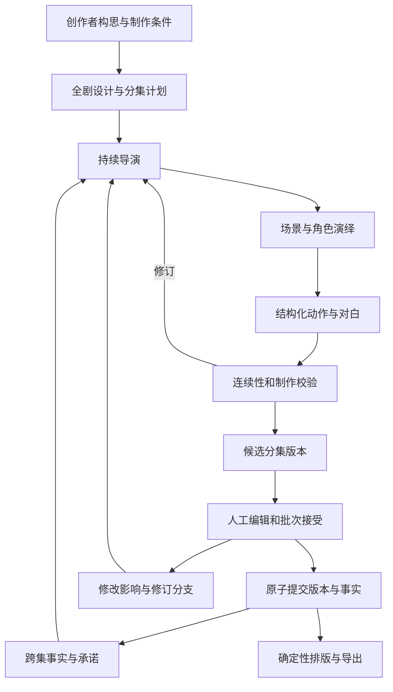

# 短剧剧本引擎 技术说明书

> 版本：v6.0 · 更新：2026-09-22
> 状态：ACTIVE — 当前技术实现唯一权威源（目标架构，非上线声明）
> 产品语义以 [PRD](Novel-Engine-PRD.md) 为准；执行顺序以 [开发计划](Novel-Engine-Plan.md) 为准。

## 1. 架构与复用边界

沿用模块化单体、FastAPI、Worker、PostgreSQL、持久事件与不可变产物存储。Regent Core 负责执行、预算、权限、恢复；产品层负责剧集、场次、制作条件、版本、记忆与接受规则。保持现有 core/src/regent/novel 和 apps/novel-web 路径，避免把目录重命名作为功能前置。

导演持续规划、观看、选择并修订；运行时执行确定性校验，独立审校不被导演覆盖。职责不等于多个常驻 Agent，不要求每场做多候选或多轮演绎。现有 Hive 仅在同时需要信息隔离且无前置依赖的局部任务中按调度规则使用；短剧转向不新增强制并发编剧要求。



## 2. 现有代码核查与目标适配

2026-09-22 的局部源码核查确认下列文件存在，并非完整能力认证。旧文档中的通过项只保留历史证据，必须复测新剧本链路。

| 当前入口 | 已观察到的用途 | 目标工作 |
|---|---|---|
| application/directing_script_loop.py | 内部剧本候选流程，仍调用章节/小说呈现与校验 | 新增短剧专用执行协议，输出 EpisodeEdition |
| domain/script_protocol.py | script/script_scene 含 WRITE_CHAPTER、ACCEPT_CHAPTER 与网文契约 | 保留旧协议兼容，隔离网文 prompt 与短剧 schema |
| application/direction.py、directing_*.py | 导演规划、角色、调用和修复入口 | 适配全剧/分集/场次及制作约束 |
| application/production.py、ledger.py | 调用恢复与账本入口 | 复用并验证 episode/batch 成本归因与预算暂停 |
| domain/memory.py、application/memory.py | 事实投影与创作记忆入口 | 增加版本分支、观众认知与剧本证据定位 |
| application/works_replay.py、works_exports.py | 重演和导出入口 | 实现修改影响、修订分支、固定快照 TXT/DOCX |
| infrastructure/models.py、api/novel.py | 现有小说持久化/API | 增量迁移和明确版本的短剧接口 |

新增产品服务建议按 planning、screenplay、revision、production_constraints、export 划分，位于现有产品包内。先抽取可复用端口，不复制整套小说应用。正文写作与审校按作品类型隔离，短剧不能进入 prose 字数或网文金手指等旧规则。

## 3. 领域模型与结构化剧本

所有新对象带 schema_version、稳定 ID、work_id、branch_id、revision、来源和内容 hash。显示集号/场号可变，引用使用稳定 ID，不以显示序号作为外键。

| 对象 | 必需字段/约束 |
|---|---|
| Work | work_type=NOVEL/SHORT_DRAMA、owner_id、active_branch_id、状态 |
| ProductionSpec | 制作形态、画幅、target_episode_count、duration_range、约束列表及版本 |
| Constraint | type、scope、hard/preference/assumption、值、来源、用户确认 |
| SeriesPlan | 主题、人物弧线、主要转折、ending、完整 EpisodePlan 列表 |
| EpisodePlan | episode_id、显示序号、目标、事件、依赖、信息揭示、悬念/兑现、目标时长 |
| Character/Location/Prop | 稳定实体 ID、名称/别名、可用状态与限制；演员与角色可显式映射 |
| EpisodeEdition | 不可变正文、父版本、plan/spec 版本、作者来源、基准 Canon、校验和时长估算 |
| Scene | scene_id、显示场号、内外景、location_id、日夜、故事时点、角色引用、正文块 |
| ScriptBlock | block_id、type、text、character_id、voice_mode、必要舞台提示 |
| Batch | 有序集范围、审核模式、预算上限、输入版本快照、运行状态 |
| ChangeRequest/ImpactReport | 基准版本、新稿/指令、依赖闭包、锁冲突、估算和确认记录 |
| EditionSelection | 分支中每集当前接受版、定稿版与拍摄基线；以事务更新 |
| ExportSnapshot | 各集 edition_id、计划/规格版本、hash、格式、状态、导出告知版本 |

ScriptBlock 类型为 ACTION、DIALOGUE、SOUND、TRANSITION；对白必须引用合法人物，画外音/独白由 voice_mode 标记。镜头说明可作有限转场提示，不建立首版分镜领域。闪回/蒙太奇需显式时间关系。原始模型文本不是最终权威正文；通过 schema 验证后的 AST 为唯一来源，页面与 TXT/DOCX 由同一 AST 排版。

质量报告定位 edition_id/scene_id/block_id 与正文证据，禁止只返回不可定位的总分。正文中未发生的计划不得写入正式事实。制作辅助表从选定 AST 提取实体引用与出场范围，含模型推断的难点须标为建议。

## 4. 状态与权威版本

### 4.1 分离运行、编辑和制作状态

- Run：QUEUED → RUNNING → AWAITING_REVIEW / COMPLETED；可进入 PAUSED_USER、PAUSED_BUDGET、BLOCKED_LOCK、RETRYABLE_FAILED、TERMINAL_FAILED、CANCELLED。可恢复状态在输入/预算/权限检查后恢复，终态不可假装续跑。
- Edition：DRAFT → VALIDATING → READY_FOR_REVIEW → ACCEPTED；审校失败保留 DRAFT 与问题，不丢人工文字。旧接受版改为非当前选择，历史不可变。
- Production lock：OPEN → FINAL_LOCKED → SHOT_LOCKED。FINAL_LOCKED 仅用户显式解锁且留痕；SHOT_LOCKED 原版永久保留，变更只能创建独立重拍分支。
- Consistency：CURRENT / NEEDS_REVIEW / BLOCKED，附着于分支版本选择，不篡改历史正文状态。

接受是成为分支中后续推演依据；定稿是用户锁定；拍摄是生产基线。模型通过校验不能自动成为人工接受。按批审核允许在同一候选分支中继续生成后集，后集引用该批前集的已校验候选，并携带依赖；批次接受时重新校验整条链并原子推广，拒绝前集则使其后候选待复核。未接受候选不能污染主分支 Canon。

### 4.2 项目完成

RUN COMPLETED 只表示本次任务完成。全剧成稿由服务计算：确认计划的全部集均有当前接受版、依赖一致、无硬失败/待复核、结局与承诺结算完成。全剧定稿再要求全部集锁定。不以模型 DONE、章节计数或批次结束直接标记整剧完成。

## 5. 创作和提交协议

1. 固定 work_type、executor_version、schema/prompt 版本和输入快照，检查用户授权的集范围与预算。
2. 编译规格、计划、所选分支事实、人物认知、观众已知信息、当前锁定项和未兑现承诺。
3. 导演规划单集和场景；必要时角色在独立信息集内演绎，结果结算后形成事件。
4. 输出结构化场景动作/对白；导演检查戏剧表达，独立审校验证事实与制作限制。
5. 有问题则定位最小场/块修订；相同问题无改善时停止同类重试，保存草稿、转重新规划或人工处理。
6. 汇集 EpisodeEdition 与临时候选事实，生成校验报告、估算时长、人物/场景/道具表，等待接受。
7. 接受事务检查权限、基准版本、父 Canon、约束、锁和依赖；提交 edition 选择、extract→verify→append-only Canon、承诺变化及 Outbox。同事务失败全部回滚。

模型与人工编辑都不能绕过事实核验直接写 Canon。失败核验不是自动接受；abstain 保留为待处理。语义争议可由用户提供纠正版本或明确事实证据后复核，不能以泛化“忽略全部问题”覆盖硬约束。

## 6. 人工编辑、影响与联动修订

编辑请求携带 expected_revision、base_edition_id 和稳定块 ID；保存创建新草稿，不覆盖当前接受版。保存时原子递增相关输入版本，在途旧模型结果只能落废弃产物，不能改新稿。并发编辑返回 409、最新版本与差异摘要，前端保留本地稿，不按最后写入者静默覆盖。

影响分析比较旧/新事件、实体关系、人物知识、观众揭示、承诺、制作条件与时间关系，构建 edition/scene 依赖闭包。内容无语义变化可有证据地标记独立；无法证明独立的内容保守列为待复核，不一定全部重写。

ImpactReport 包含 base_hash、spec_version、锁快照、受影响集/场、原因和证据、需重验/重写分类、费用上限、时长区间和 available_actions。确认时再核验快照；变化则 409 并重算。确认授权只覆盖所列范围与金额，不包含已拍摄覆盖或新增付费授权。

修订在新分支运行。通过全部必需校验后，用 CAS 在事务内切换 active_branch 和整套 EditionSelection；失败保留旧主分支和新草稿。共享未变更版本，不复制/污染历史事实。回退是重新选择历史分支的受控变更，仍检查锁和依赖，不删除后来的账本。

定稿解锁必须显式独立 mutation；不能隐含在“重写”按钮中。已拍摄内容的反向依赖冲突阻断推广，建议调整后续内容或建立重拍分支。拍摄基线引用不可变 edition_id，不能在恢复历史版本时被替换。

## 7. 记忆和上下文

保留导演、角色、编剧、审校、观众、运行时六类视图。导演可见未来计划但事实/假设/计划分区；角色仅获得当前故事时点本人可知内容；编剧可见本场允许表达的信息，不把全剧秘密混入台词。跨轮重新编译，不复用含其他角色秘密的共享会话。

ContextManifest 记录选用 edition、branch、Canon 版本、证据、计划/规格/锁版本、token 裁剪策略和 hash。按需召回有界历史，不能始终把全剧正文塞进 prompt。缺失知识默认无权限。镜头外事件、闪回和观众已知但角色未知分别处理。

历史事实日志保持 append-only；新分支以父快照加事件派生状态，改稿产生 supersedes/retract 事件且只影响新分支，不能修改原事件。废弃候选不进入共享记忆。悬念含建立、预期兑现范围、实际证据与 OPEN/RESOLVED/INTENTIONALLY_OPEN 状态；开放结尾须用户明确接受。

## 8. 制作校验和时长

确定性检查：schema 完整性、实体引用、场号唯一、集数范围、锁与版本一致性、明确演员/场地/道具白名单及数量限制。人物和演员不等价，未配置映射时不得声称知道真实演员人数。

语义检查：信息差泄漏、事件矛盾、动作是否可表演、制作难点、场次时间衔接、兑现与结局。结论带 severity、证据、rule/model 版本和 pass/fail/abstain。

时长模型由对白语速区间、动作时长估计、停顿、转场及重叠规则构成；不能盲目相加并行对白/动作。存储组件估计、区间、置信度、校准版本。使用围读时间回填误差；校准前明确为估算。偏好超出只告警，用户指定的硬时长范围无可接受估计时阻断定稿并请求复核。

## 9. 调用、成本、幂等与恢复

沿用统一 ModelGateway/CallBroker，logical_call 与 attempt 分离。生成调用须有 work/branch/episode/scene/command、purpose 和 cost_scope；全剧规划按 work/batch 归因。调用前原子检查已消费与在途预留之和加本次预估，不超过项目/批次/分集适用上限；金额以整数 minor unit 和 currency 存储。

先预留、事务外调用、终态消费/释放/补记。实际超出预估必须如实补记并暂停后续调用，不得丢账；因此上限是调用前支出控制，不承诺供应商实际费用绝无估算误差。预留核验/收尾额度，预算不足 PAUSED_BUDGET，补充授权后复用检查点，不清空累计账、不自动加重试次数。废弃/失败调用费用也保留。

| 操作 | 幂等身份 |
|---|---|
| 项目/编辑/接受/锁/导出 mutation | principal + route + Idempotency-Key；同键异参 409 |
| 生成步骤 | work:branch:episode:scene:command:input_version |
| 模型调用 | logical_call_id + purpose + 模型/sampling/prompt/context/schema 指纹 |
| Canon 接受 | branch:episode:edition_hash:parent_canon_version |
| 结算 | logical_call_id:attempt:funding_pool:entry_type |
| 批次推广 | change_id:base_branch_version:selection_hash |

成功 logical_call 恢复复用，不重复内部消费或提交。UNKNOWN 保留供应商 request_id，按 reconcile_count 而非 attempt 有界查询；默认静默期 60 秒、对账最多 3 次可配置。达到上限无法核实时按保守估算入账并保留来源/未知标记，后续真实账单以追加调整流水纠正；没有供应商幂等/查询能力不能承诺外部 exactly-once，重试前展示可能重复费用并受剩余授权约束。

Worker 启动及周期扫描过期 RESERVED/UNKNOWN。写回结果和提交前均回查 owner、fencing_token、租约有效期、input_version、branch/spec/lock 版本；禁止依赖内存 ORM 缓存判断。暂停/取消期间已发起调用允许结账，但不得越权接受结果。

## 10. 目标 API 与事件

以下是待实现的 /v1/drama 契约，不代表当前接口存在。旧 /v1/novel 仅服务旧作品；授权、模型调用与持久化通过共用服务复用。OpenAPI 生成 TypeScript DTO，核心字段使用明确 schema/enum。

```text
POST/GET /v1/drama/works
GET      /v1/drama/works/{id}
PUT      /v1/drama/works/{id}/production-spec
POST     /v1/drama/works/{id}/plans/generate
PUT      /v1/drama/works/{id}/plans/{planId}
POST     /v1/drama/works/{id}/plans/{planId}/accept
POST     /v1/drama/works/{id}/batches
POST     /v1/drama/works/{id}/batches/{batchId}/accept
POST     /v1/drama/works/{id}/runs/{runId}/pause
POST     /v1/drama/works/{id}/runs/{runId}/resume
POST     /v1/drama/works/{id}/runs/{runId}/cancel
GET      /v1/drama/works/{id}/episodes/{episodeId}
GET      /v1/drama/works/{id}/episodes/{episodeId}/editions
POST     /v1/drama/works/{id}/episodes/{episodeId}/drafts
POST     /v1/drama/works/{id}/episodes/{episodeId}/validate
POST     /v1/drama/works/{id}/episodes/{episodeId}/accept
POST     /v1/drama/works/{id}/episodes/{episodeId}/locks
POST     /v1/drama/works/{id}/changes
GET      /v1/drama/works/{id}/changes/{changeId}
POST     /v1/drama/works/{id}/changes/{changeId}/confirm
POST     /v1/drama/works/{id}/changes/{changeId}/promote
POST     /v1/drama/works/{id}/branches
POST     /v1/drama/works/{id}/exports
GET      /v1/drama/works/{id}/exports/{exportId}
POST     /v1/drama/works/{id}/shares
DELETE   /v1/drama/works/{id}/shares/{shareId}
GET      /v1/drama/works/{id}/events
```

所有 mutation 支持幂等；编辑/计划/规格/锁/推广携带 expected_revision。生成/校验/导出异步返回 202 与资源 ID。错误 envelope：code/message/request_id/retryable/available_actions，409 给当前版本摘要，429 给 Retry-After。分支创建支持修订/历史恢复/重拍三类，不能偷偷切换当前版本。

事件含 event_id、递增 sequence、schema_version、work/branch/episode、causation_id、correlation_id。最低事件：plan.ready、episode.draft_saved、episode.ready、episode.accepted、impact.ready、revision.promoted、lock.changed、run.paused/resumed/failed、budget.exhausted、export.ready、share.revoked。Outbox 与业务提交原子；SSE 按 sequence 去重、补帧，缺口/超保留窗请求快照重同步。连接心跳不代表数据健康。

## 11. 前端、权限与导出

沿用 React/TypeScript/Vite，按 PRD 页面迁移。剧本编辑器使用块 ID、段落类型和实体选择，避免通过解析自由富文本猜角色。保存状态、版本差异、冲突副本和在途生成明确可见；离线保存本地草稿需用户知情，重连以服务端版本合并。定稿、拍摄、接受、支付和修改确认不能离线排队。

UXProjection 返回真实阶段、完成范围、下一交付、ETA 区间、已消费/在途预留、预算余量、待办和 available_actions。前端不根据模型步骤猜成功，不显示无依据精确百分比。URL 和服务端快照可恢复页面。

服务端认证解析 principal；所有作品、版本、记忆、导出和事件查询过滤 owner/tenant。首版只读分享 token 绑定范围、固定版本和失效时间，可撤回，不授予写权限。不把角色私密推演或内部 trace 暴露给只读审阅。资源越权不泄露存在性。

正文默认不进入共享浏览器缓存；登出/撤回清理客户端缓存。撤回只停止后续访问，不能承诺召回已下载副本。删除采用软删除并按确认后的财务/创作证据保留政策归档。保留审核、投诉、申诉和 AI 标识，无结论不视作审核通过。

导出只读确定的 ExportSnapshot，不调用模型。TXT/DOCX 使用相同 AST；完整/选集、草稿/成稿/定稿均明确标注，阻止将缺集或待复核包标记全剧定稿。校验 ExportNotice 版本；附目录、版本、AI 参与标识和辅助表。文件名/内容转义、格式白名单、对象访问授权；导出任务执行和下载时再次验证权限。

## 12. 验证与架构守卫

| ID | 不变式 |
|---|---|
| DG-01 | 短剧路径不执行小说正文渲染或网文硬模板 |
| DG-02 | 模型/人工草稿都不能直接写 Canon，候选分支不得污染主分支 |
| DG-03 | 人物上下文按时间点与权限编译，废弃候选不可召回 |
| DG-04 | 成功调用复用；预算/租约/输入版本在数据库原子检查 |
| DG-05 | 人工文字和已拍摄版本不能被旧调用或恢复覆盖 |
| DG-06 | 定稿显式解锁，拍摄基线不可覆盖，锁快照变化使旧确认失效 |
| DG-07 | 联动修订按依赖计算，推广原子，不留混合版本事实 |
| DG-08 | 整剧完成依据全部正文和一致性，不依据 run DONE |
| DG-09 | 时长估算标注来源/区间，制作硬约束与偏好分开 |
| DG-10 | 阅读/分享/导出不生成，导出版本和正文一致 |
| DG-11 | 服务端主体与 owner 过滤、AI 标识和审核证据必需 |
| DG-12 | 记忆、账本、版本和审计可追溯；软质量须经人工校准 |

验证覆盖 schema、编辑冲突、规则、真实 PostgreSQL 并发/崩溃、Worker 恢复、浏览器主旅程及导出打开/排版检查。必须注入：编辑期间模型返回、过期 Worker 提交、锁在确认后改变、批次中途失败、UNKNOWN、预算耗尽、分享撤回、导出期间版本切换。全剧软质量采用同模型/预算带的盲评并记录实际人工改稿时长；自动 Judge 仅作诊断。

## 13. 迁移、灰度与回退

增量添加 work_type（旧记录默认 NOVEL）、executor/schema 版本和 drama 专用表/JSON schema；旧小说不自动改成短剧。新 work_type 由服务端创建流程约束，不能通过任意更新把旧作品改型。在途 run 固定原执行器/协议，新建短剧显式选择 drama_v1，未知版本 fail closed。

迁移先盘点表、接口、prompt 和测试，再通过空库安装/存量升级/备份恢复验证；本版不声称现有迁移可无损 downgrade。新功能按作品白名单启用。关闭短剧创建/生成开关可回退流量，现有短剧仍可读取、导出和保存草稿；不删除新表、不降级剧本到小说、不覆盖用户稿。

无授权/范围不明的旧运行不因文档转向自动取消。生产切换前盘点并按原协议完成或用户暂停。保留已确认成功调用与账本，避免新旧执行器重复领取。旧 novelMaker/网文评测只作技术历史，短剧质量基线另建。

## 14. 修订记录

v6.0：以短剧结构化正文、制作条件、版本编辑、分支改稿与拍摄基线替代小说呈现目标；保留运行/账本/权限/记忆约束。v5.3 全文及旧架构守卫编号见 [历史快照](docs/archive/novel-before-short-drama-2026-09-22/README.md)，不得将旧 G 编号直接映射为新 DG 验收完成。
